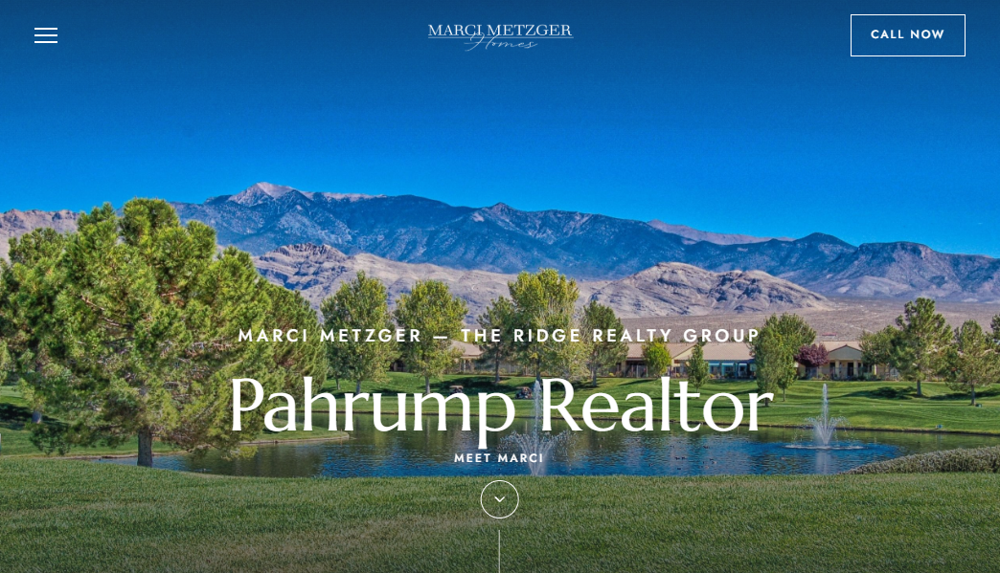

# Marci Metzger Homes: Homepage Redesign

A homepage redesign of a real estate agent's site, built as a take-home test.

This is a take-home project for a job application, not affiliated with Marci Metzger, The Ridge Realty Group, or Luxury Presence. Content and images belong to their owners.

Here is the live link: **Live site:** [marci-metzger-green.vercel.app](https://marci-metzger-green.vercel.app/)

## Tech Stack

React, Vite, CSS Modules, react-icons, Vercel.

This project was made with assistance of Claude.

## Highlights/Design Changes from the original

- "Call Now" moved into a sticky header, so visitors can call from anywhere on the page
- Visual overhaul of the entire page but not abandoning the style of the previous
- Putting the action flow of the listings search to a modal so it separates itself from the home page itself and avoids clutter
- Put fancy css animations for a more presentable and intuitive style but still with purpose

